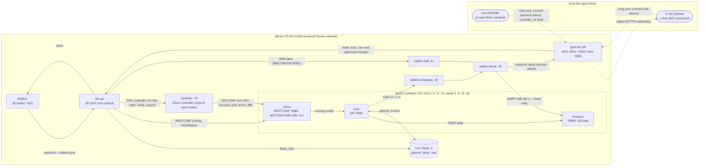

# NetSim L2VPN lab

A lab that simulates a hub-and-spoke L2VPN (VPWS pseudowire) network with redundancy: ten virtual PE routers in two
regions (Clixon YANG/RESTCONF + simulated LDP signaling + SNMP), NetBox as the source of truth, Zabbix 8.0 monitoring
with a NetBox-driven business-service tree, a lab API (the NOC's tool surface) and **grok-bot**: the office of three
NOC roles (NOC Engineer, Network Engineer, NOC Manager), each a routine of your Grok Bot app. Zabbix pages them
through grok-bot; they triage, acknowledge, find root causes and propose fixes; the NOC Manager reviews each fix and
a human approves it; grok-bot applies and verifies them. All of it shows live in a pixel-art **NOC room** at
<http://127.0.0.1:8095>. A **Clixon controller** manages the routers over NETCONF and notices when one no longer
matches the config the lab last put there (out of sync); the roles read it through a real controller CLI, read
only, and the room shows every command on its terminal.

Each region has its own hub pair: **North** = hub-a/hub-b with spoke-1..4, **South** = hub-c/hub-d with spoke-5..6.
Six customers in three SLA tiers (gold, silver, bronze) have eleven services: protected ones are dual-homed to their
region's two hubs, the bronze customer's are **unprotected** (one PW, one hub). So a hub failure hits one region,
not the lab, and the same failure degrades a gold service but takes a bronze one down.

Two rules run through every component: **traps are hints, polling is truth**, and **config is intent/drift, faults
are physical failures**. The shared interface spec is [`docs/CONTRACT.md`](docs/CONTRACT.md); its machine-readable
parts are in [`contract/`](contract/README.md).

## Architecture



## Quickstart (5 minutes)

Prerequisites: Linux, Docker Engine 24+ with Compose v2.20+, [uv](https://docs.astral.sh/uv/) (`make doctor`).
The first `make build` compiles Clixon and Zabbix 8.0.0rc1 from source (~12 min, once); NetBox's first start
migrates its database (4-8 min, once). After that:

```bash
make env net build up    # secrets, labnet, images, every container
make seed                # waits for healthy containers, seeds NetBox, provisions Zabbix from NetBox
uv run labctl status     # controller: 10/10 connected, 10 in sync; 11 services, every PW up, Zabbix OK
```

Open the NOC room at <http://127.0.0.1:8095>: three robots, NOCENG at the Zabbix console, NETENG between the rack
and the NetBox cabinet, NOCMGR by the incident board; the wall screen shows the Zabbix services. With sound on (🔊,
it starts at your first click in the page) the room plays chiptune music, an alarm while an incident is open and a
jingle when the network recovers. They are your
**Grok Bot app**: three Bots, each with its role's MCP connector (`/mcp` through a tunnel) and a webhook routine that
grok-bot pages when Zabbix alerts. Setup, skills and five demos: [`bot/grokbot-app/`](bot/grokbot-app/README.md);
how the office works: [`bot/README.md`](bot/README.md). Without the app, `make bot-sink-up` records the pages and
`uv run botctl call --role <role> ...` plays a role.

Then break something and watch it:

```bash
uv run labctl status --watch                       # terminal 1: intent | spoke end | hub end | Zabbix, live
uv run labctl scenario apply fake-redundancy       # terminal 2: SVC-0002 "redundant" through hub-b only
uv run labctl drift                                #   "SVC-0002: both PWs terminate on hub-b ... redundancy lost"
uv run labctl impact hub-c                         #   before maintenance: per service and SLA tier, who gets hurt
uv run labctl scenario apply region-down           #   the South region loses both hubs: only its 3 services down
uv run labctl reset                                #   back to golden, faults cleared, wait until green
```

Or let the NOC handle it: apply a scenario and watch the NOC room. Zabbix pages the NOC Engineer (one page per fault,
however many customers it hits), who triages and files a field ticket or escalates to the Network Engineer; the NOC
Manager reviews every ticket and proposes it to you (or returns it to its engineer); you approve at the operator desk
(or `uv run botctl approve --incident INC-0001`), and grok-bot applies the tickets make before break and verifies
through simd and Zabbix.

Zabbix: <http://127.0.0.1:8080> (`Admin` / `ZABBIX_ADMIN_PASSWORD` in `.env`, dashboard **L2VPN Services**),
NetBox: <http://127.0.0.1:8000>, lab-api (the bot's tools): <http://127.0.0.1:8090/docs>, the NOC room:
<http://127.0.0.1:8095>. Every scenario, what to
look at, and troubleshooting: [`docs/RUNBOOK.md`](docs/RUNBOOK.md). Full check: `make e2e` (~22 min).

## Run order

The lab is built by sessions ([`prompts/`](prompts/README.md)): **01-foundation** first (this scaffolding,
the contract artifacts and `lib/netsim_common`), then **02-device-simulator**, **03-netbox** and **04-zabbix** in
parallel, then **05-integration**, then **06-topology-v2** (second region, new customers, unprotected bronze
services), then **07-grok-bot** (the NOC bot and the NOC room), then **08-grokbot-app** (the Grok Bot app as an
outside agent: MCP, pager, demos), then **09-noc-roles** (three Grok Bot roles paged by Zabbix through grok-bot, link
traps, lab-api direct reads), then **10-clixon-controller** (a Clixon controller in front of the routers, NETCONF over
SSH on the PEs, the roles' read-only `controller_cli` and the room's terminal). Each session writes
`docs/reports/NN-<name>.md`.

Bring-up on a Linux host with Docker Engine 24+, Compose v2.20+ and [uv](https://docs.astral.sh/uv/):

```bash
make doctor          # check prerequisites
uv sync              # Python 3.12 workspace (all members + dev tools)
make env             # .env with random secrets (never overwrites)
make net             # external network labnet (idempotent)
make build up        # images and containers
make seed            # NetBox from the topology, then Zabbix from NetBox
make e2e             # end-to-end scenarios
```

Until a component has landed, its targets print `not implemented yet (owner: session NN)` and fail.

## Make targets

| Target | What it does |
|---|---|
| `make doctor` | Check Docker Engine 24+, Compose v2.20+, uv |
| `make env` | Create `.env` from `.env.example` with random secrets; later runs only append new variables |
| `make sync` | `uv sync` (workspace members + dev tools) |
| `make net` | Create the external network `labnet` 172.30.10.0/24 (idempotent; fails if it exists with other settings) |
| `make up` / `down` / `ps` / `logs [S=svc]` | Compose wrappers for the whole lab (`down` keeps volumes) |
| `make build` | Build the lab images (PE, lab-api, grok-bot, the Clixon controller) |
| `make seed` | `netbox-seed` then `zabbix-provision` |
| `make reset` | `lab-reset`: devices back to golden config, faults cleared |
| `make test` | Unit tests (no running lab needed; YANG checks use a pinned yanglint container) |
| `make e2e` | `bot-e2e` (the NOC office with the routine sink and a scripted role player), `controller-test` (the controller: in sync, out of sync, NACM on its own), then `lab-e2e`: end-to-end tests against the running lab |
| `make lint` | ruff (lint + format check), `pyang --strict`, yanglint (schema + golden configs) |
| `make fmt` | ruff format + autofix |
| `make contract` / `contract-check` | Regenerate / verify generated contract artifacts (golden, OIDs, schemas, YANG tree) |
| `make yang-clixon` | Load the YANG into a real Clixon 7.9.0 and validate golden configs and examples |
| `make clean CONFIRM=yes` | **Deletes all lab volumes** (device configs, NetBox/Zabbix databases) and `labnet` |

Component targets (`devices-*`, `netbox-*`, `zabbix-*`, `lab-*`, `bot-*`, `controller-*`) live in
`<component>/<component>.mk`; `make controller-shell` opens the controller's CLI.

## Addresses and ports

Published ports bind to `127.0.0.1` only. Device host port = base + last octet of the mgmt IP.

| Host | Role | Region | Mgmt IP | Loopback0 | RESTCONF | simd API | SNMP (udp) |
|---|---|---|---|---|---|---|---|
| `hub-a` | hub (primary), DC-A | North | 172.30.10.11 | 10.255.0.1 | 18011 | 19011 | 16111 |
| `hub-b` | hub (backup), DC-B | North | 172.30.10.12 | 10.255.0.2 | 18012 | 19012 | 16112 |
| `hub-c` | hub (primary), DC-C | South | 172.30.10.13 | 10.255.0.3 | 18013 | 19013 | 16113 |
| `hub-d` | hub (backup), DC-D | South | 172.30.10.14 | 10.255.0.4 | 18014 | 19014 | 16114 |
| `spoke-1` | spoke, BR-01 | North | 172.30.10.21 | 10.255.1.1 | 18021 | 19021 | 16121 |
| `spoke-2` | spoke, BR-02 | North | 172.30.10.22 | 10.255.1.2 | 18022 | 19022 | 16122 |
| `spoke-3` | spoke, BR-03 | North | 172.30.10.23 | 10.255.1.3 | 18023 | 19023 | 16123 |
| `spoke-4` | spoke, BR-04 | North | 172.30.10.24 | 10.255.1.4 | 18024 | 19024 | 16124 |
| `spoke-5` | spoke, BR-05 | South | 172.30.10.25 | 10.255.1.5 | 18025 | 19025 | 16125 |
| `spoke-6` | spoke, BR-06 | South | 172.30.10.26 | 10.255.1.6 | 18026 | 19026 | 16126 |

Customers (tier): Customer-A, -B, -E (gold, 99.95 %), Customer-C, -D (silver, 99.9 %), Customer-F (bronze, 99.5 %,
unprotected services SVC-0009 and SVC-0010). The service table is in [`docs/CONTRACT.md`](docs/CONTRACT.md) §5.

| Service | Mgmt IP | Host port |
|---|---|---|
| `core` (Redis signaling bus) | 172.30.10.5 | - |
| NetBox UI/API | 172.30.10.30 | 8000 |
| `zabbix-server` | 172.30.10.40 | - |
| Zabbix UI/API (`zabbix-web`) | 172.30.10.41 | 8080 |
| `zabbix-snmptraps` | 172.30.10.42 | - |
| `lab-api` | 172.30.10.50 | 8090 |
| `grok-bot` (NOC room, bot API, `/mcp`, `/hooks/zabbix`) | 172.30.10.60 | 8095 |
| `routine-sink` (tests; compose profile `sink`) | 172.30.10.61 | 8096 |
| `controller` (Clixon controller; SSH :22 for lab-api, the PEs' NETCONF :830, labnet only) | 172.30.10.70 | - |

`uv run netsim-contract hosts` prints the same data from `contract/topology.yaml`.

## Repository layout

| Path | Owner | Contents |
|---|---|---|
| `docs/CONTRACT.md`, `docs/reports/` | all | contract (change log), session reports |
| `contract/` | 01-foundation | topology, YANG, golden configs, MIBs + OIDs, JSON schemas |
| `lib/netsim_common/` | 01-foundation | shared Python models and helpers |
| `tools/`, `tests/` | 01-foundation | generators, checkers, contract tests |
| `devices/` | 02-device-simulator | PE image (Clixon + simd + snmpsim), core |
| `netbox/` | 03-netbox | NetBox deployment, seeder, intent renderer |
| `zabbix/` | 04-zabbix | Zabbix deployment, template, provisioning, BSM sync |
| `lab/` | 05-integration | labctl, lab-api, scenarios, e2e tests |
| `bot/` | 07-grok-bot (09-noc-roles) | grok-bot (the NOC office of three roles, NOC room, routine sink, botctl), the Grok Bot app's side (`bot/grokbot-app/`) |
| `controller/` | 10-clixon-controller | the Clixon controller: image, NACM and PEs generated from the topology, sshd, connect agent, tests |
